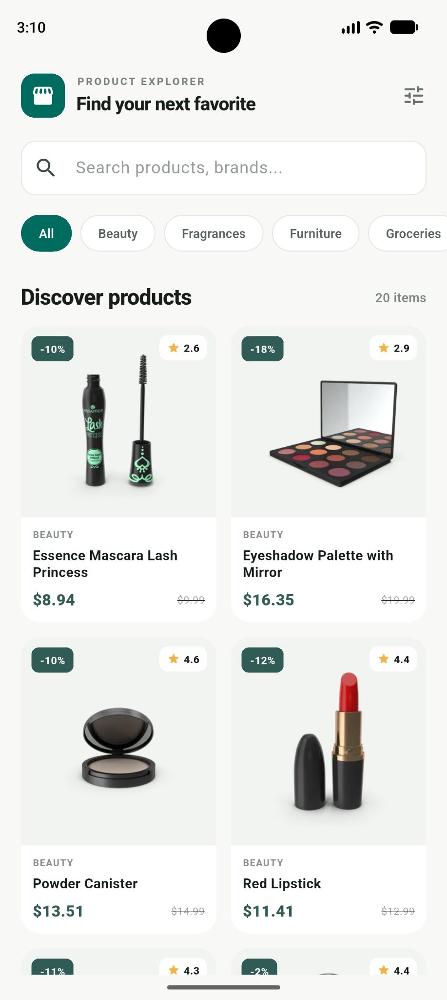
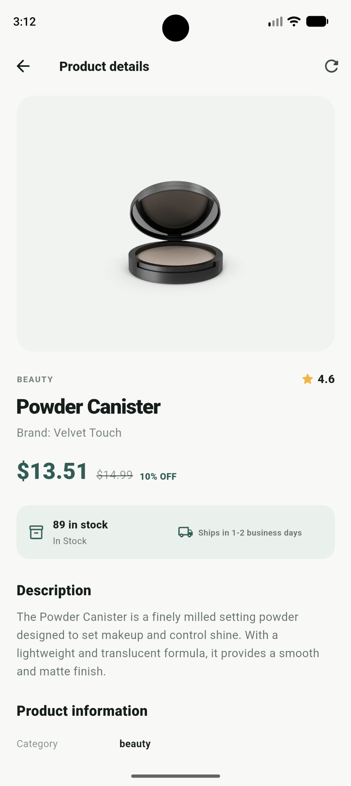

# Product Explorer

A Flutter application for browsing products and viewing product information using the [DummyJSON Products API](https://dummyjson.com/docs/products).

## Screenshots

| Product listing | Product details |
|---|---|
|  |  |

## Features

- Fetches products from DummyJSON; the catalogue is not hardcoded.
- Product listing with product image, title, category, price, discount and rating.
- Search by product title, brand or category across products currently loaded in the list.
- Category filtering across products currently loaded in the list.
- Infinite-scroll pagination and pull-to-refresh.
- Product detail screen with image gallery, description, price, discount, rating, brand, category, stock, shipping information, SKU, dimensions, tags and customer reviews when supplied by the API.
- Loading, empty and error states with retry actions.
- Offline fallback using locally cached product pages and product details.
- BLoC-based state management and repository abstraction.

## Tech stack

- Flutter and Dart
- `flutter_bloc` for presentation state management
- `dio` for HTTP requests
- `equatable` for value equality
- `cached_network_image` for network image caching
- `shared_preferences` for lightweight offline JSON cache
- `bloc_test` and `mocktail` for automated tests

## Requirements

- Flutter SDK compatible with the Dart SDK constraint in `pubspec.yaml`.
- Android Studio or another Flutter-supported IDE.
- Internet connection for the initial API fetch and uncached products.

## Setup

1. Clone the repository:

   ```bash
   git clone https://github.com/shiblisha/abeltechsoft-product-explorer.git
   cd abeltechsoft-product-explorer
   ```

2. Install dependencies:

   ```bash
   flutter pub get
   ```

3. Run static analysis:

   ```bash
   flutter analyze
   ```

4. Run the application:

   ```bash
   flutter run
   ```

## API

The app uses these DummyJSON endpoints:

- Product pages: `GET https://dummyjson.com/products?limit=20&skip=0`
- Product details: `GET https://dummyjson.com/products/{id}`
- Product categories: `GET https://dummyjson.com/products/category-list`

The base URL and request configuration are defined in `lib/core/network/dio_client.dart`.

## Architecture

The code is organized by feature, with the products feature separated into data, domain and presentation layers.

```text
lib/
├── core/
│   └── network/
│       └── dio_client.dart
├── features/
│   └── products/
│       ├── data/
│       │   ├── datasources/
│       │   │   ├── product_remote_data_source.dart
│       │   │   └── product_cache_data_source.dart
│       │   ├── models/
│       │   │   ├── product.dart
│       │   │   └── product_response.dart
│       │   └── repositories/
│       │       └── product_repository_impl.dart
│       ├── domain/
│       │   └── repositories/
│       │       └── product_repository.dart
│       └── presentation/
│           ├── bloc/
│           ├── pages/
│           └── widgets/
└── main.dart

test/
├── bloc/
├── data/
├── helpers/
├── models/
└── widget_test.dart
```

### Data flow

1. Pages dispatch events to the relevant BLoC.
2. BLoCs call the `ProductRepository` abstraction.
3. `ProductRepositoryImpl` requests data through `ProductRemoteDataSource`.
4. The remote data source uses the configured Dio client to call DummyJSON.
5. Successful responses are cached through `ProductCacheDataSource`.
6. If a network request fails, the repository attempts to return the corresponding cached page or product detail. If no cached value exists, the error is passed to the presentation layer.

## Offline behavior

The app uses `SharedPreferences` to store JSON representations of successfully fetched product pages and product details.

- Product pages are cached by page size and offset.
- Product details are cached by product ID.
- A cached page or detail can be displayed when the corresponding network request fails.
- A product that has never been fetched and cached cannot be guaranteed to be available offline.
- This lightweight cache is suitable for the scope of this assessment. A larger catalogue or more complex offline synchronization requirement would be better served by a local database such as SQLite or Isar.

## Automated tests

Run all tests with:

```bash
flutter test
```

The test suite covers model parsing/serialization, cache read/write behavior, product-list BLoC success and failure states, pagination, product-detail BLoC states, and a widget smoke test.

Tests use mocked repositories and mocked SharedPreferences. They do not require the live DummyJSON API or an internet connection.

For a verbose test report:

```bash
flutter test --reporter expanded
```

## Build

To create a debug APK:

```bash
flutter build apk --debug
```

To create a release APK:

```bash
flutter build apk --release
```

The release APK is generated at:

```text
build/app/outputs/flutter-apk/app-release.apk
```

## Git hygiene

Generated build output, local IDE state, SDK paths, and machine-specific configuration are excluded using `.gitignore`. In particular, do not commit `build/`, `.dart_tool/`, `.idea/`, `android/local.properties`, or signing credentials.

## Notes

- Prices are displayed in USD, matching the currency representation in DummyJSON's sample product data.
- Search and category filters apply to the products currently loaded in the listing; pagination loads additional products from the API.
